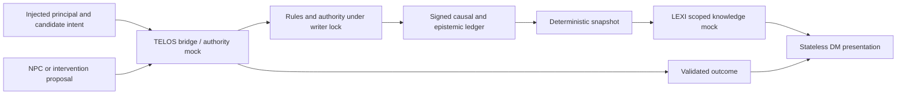

# ARGO status and architecture reference

Visibility rechecked on **2026-11-14**: `dsmcewan/ARGO` is **public**. The owner authorized public pushes in this conversation. The CI/source timeline below is historical; newer review repairs and their exact verification identities are in [review successors](docs/review-successors/README.md).

Checked **2026-11-13** against Git history, GitHub Actions job logs and the implementation sources. The verified implementation baseline is [`e2f4d7efa2b6db8826bcc870e0f709f85e97079a`](https://github.com/dsmcewan/ARGO/commit/e2f4d7efa2b6db8826bcc870e0f709f85e97079a), which passed on both the research branch and `main`. This reference adds documentation; it does not change runtime behavior or frozen contracts.

**Current state:** the four-phase foundation and the offline build board are implemented and verified. Five starter research reports and an 11-ticket headless planning seed are saved. Paid vendor runs and live gameplay service deployment have not been performed or verified in this work. The proposed two-plane graph stores and general component bus remain unimplemented in this repository.

For the consolidated present/target/data/build-dependency guide, read [SYSTEM_ROADMAP.md](SYSTEM_ROADMAP.md). It is planning documentation; the frozen contracts and historical evidence below retain their scope.

## Subsequent review and active repairs

The review of `a9745e72e93d82c72e87f5159edd5c59f4c426c0` found two P1, eight P2 and six P3 issues that the earlier passing suites did not cover. [The original review](REPAIRS/REVIEW_2026-11-13.md) and [repair resolutions](REPAIRS/RESOLUTIONS.md) supersede any implication that the historical verification below establishes unattended-build readiness. All twelve contained findings have been repaired across five disjoint blackboard lanes and independently reviewed; the integrated code at `ff22632` passed all ten unified gate groups. Four versioned-contract/storage decisions remain held back; no paid vendor runs are authorized.

The main CI at `a9745e7` [passed](https://github.com/dsmcewan/ARGO/actions/runs/43456584810). This closes the old pending-save instructions; it does not close the subsequent review findings. Board v1 coordinated real leases, path claims and CAS handoffs, but its immutable data-only policy cannot accept application/control-policy changes. The batch is operationally retired with its actual states preserved. External verification and retirement records are under `REPAIRS/acceptance/`; no board MERGED state was fabricated.

## CI failures, repairs and timestamps

All runs below belong to the same repository, **`dsmcewan/ARGO`**. `argo/foundation-spine` and `argo/rpg-research` are branches. Times are GitHub's run **last-updated** timestamps on November 13, converted to EST (UTC−05:00); they are not notification delivery or deployment timestamps.

| Commit | Branch | Result and run | Last updated UTC | EST |
|---|---|---|---|---|
| `280136e` | `argo/foundation-spine` | [Passed](https://github.com/dsmcewan/ARGO/actions/runs/43438148698) | 13:58:26 | 08:58:26 |
| `9ba82dc` | `argo/foundation-spine` | [Failed](https://github.com/dsmcewan/ARGO/actions/runs/43438731795) | 14:02:26 | 09:02:26 |
| `9ba82dc` | `main` | [Passed](https://github.com/dsmcewan/ARGO/actions/runs/43438900607) | 14:03:15 | 09:03:15 |
| `05a292c` | `argo/foundation-spine` | [Passed](https://github.com/dsmcewan/ARGO/actions/runs/43439533628) | 14:07:32 | 09:07:32 |
| `05a292c` | `main` | [Passed](https://github.com/dsmcewan/ARGO/actions/runs/43439886374) | 14:09:39 | 09:09:39 |
| `401b5e3` | `argo/rpg-research` | [Failed](https://github.com/dsmcewan/ARGO/actions/runs/43449157492) | 15:07:26 | 10:07:26 |
| `e2f4d7e` | `argo/rpg-research` | [Passed](https://github.com/dsmcewan/ARGO/actions/runs/43449931341) | 15:12:02 | 10:12:02 |
| `e2f4d7e` | `main` | [Passed](https://github.com/dsmcewan/ARGO/actions/runs/43450515719) | 15:15:52 | 10:15:52 |

At `9ba82dc`, the foundation gate passed, then the full harness suite failed `an unreadable lock file is reclaimed only after staleMs`. The fixture assumed a freshly written fractional filesystem timestamp was already behind integer `Date.now()`. The same commit passing in a separate run did not remove that timing dependency. [`05a292c`](https://github.com/dsmcewan/ARGO/commit/05a292c) pinned both clocks and checked refusal at 0 and 59,999 ms, then reclamation at 60,000 ms. Production locking was unchanged. See [the repaired test](pantheon/tests/seat-lock.test.mjs) and [foundation verification](repo-audit/evidence/foundation-verification.json).

At `401b5e3`, the foundation gate passed, then the new tool suite failed `test_aggregate_capture_budget_stops_before_reading_later_files`. Its sentinel assumed `os.scandir` would return filenames alphabetically. [`113531a`](https://github.com/dsmcewan/ARGO/commit/113531a) changed the test to count actual opens: for its three new eight-byte files and eight-byte/one-artifact budget, capture must stop by the second file. Independent review checked all six enumeration orders and confirmed that the original unbounded collector still fails this oracle. Production capture code was unchanged by this repair. `e2f4d7e` records the repair and includes it in the passing candidate. See [the test](tools/test_dispatch.py) and [board verification](repo-audit/evidence/research-blackboard-verification.json).

Thus `9ba82dc` and `401b5e3` are documentation checkpoints associated with the observed failures. The corrective test commits are `05a292c` and `113531a`; `e2f4d7e` is the verified combined implementation baseline.

## Commit map

| Commit | Role in the current implementation |
|---|---|
| [`1f54367`](https://github.com/dsmcewan/ARGO/commit/1f54367) | Foundation verification record's implementation snapshot, including isolated npm configuration repair. |
| [`280136e`](https://github.com/dsmcewan/ARGO/commit/280136e) | Reviewed foundation checkpoint with a passing CI run. |
| [`9ba82dc`](https://github.com/dsmcewan/ARGO/commit/9ba82dc) | Four-phase completion and verification documentation. |
| [`05a292c`](https://github.com/dsmcewan/ARGO/commit/05a292c) | Deterministic lock-expiry test repair; research baseline. |
| [`90bc419`](https://github.com/dsmcewan/ARGO/commit/90bc419) | Research reports, dispatcher charter, headless planning seed, integration tests and CI additions. |
| [`a55feb1`](https://github.com/dsmcewan/ARGO/commit/a55feb1) | Offline fenced board, trusted data-gate wrapper and engine tests. |
| [`822f42e`](https://github.com/dsmcewan/ARGO/commit/822f42e) | Confined offline dispatcher and its tests. |
| [`8fba0d5`](https://github.com/dsmcewan/ARGO/commit/8fba0d5) | Incrementally bounded artifact capture. |
| [`f26c764`](https://github.com/dsmcewan/ARGO/commit/f26c764) | Explicit offline seat labels and independent lease-expiry cancellation. |
| [`401b5e3`](https://github.com/dsmcewan/ARGO/commit/401b5e3) | Board/research verification record and operating limits. |
| [`113531a`](https://github.com/dsmcewan/ARGO/commit/113531a) | Directory-order-independent capture-budget test. |
| [`e2f4d7e`](https://github.com/dsmcewan/ARGO/commit/e2f4d7e) | Repair record; combined candidate verified on research and `main`. |

## Implemented architecture

The [System Bible](ARGO_SYSTEM_BIBLE.md) explains the design. [Frozen v1 contracts](SYSTEMS/CONTRACT_FREEZE.json) remain normative: 36 JSON Schema definitions, contract version `1.0.0`, ruleset `tempted-fates/1.0.0`. Normative service responsibilities must be distinguished from deployed services; current bridges use injected transports and explicit in-process mocks.

| Component | Implemented behavior | Boundary or remaining responsibility |
|---|---|---|
| [Contracts](packages/contracts/src/index.ts) | Schema validation, full tenant/rights/workspace/campaign/world/branch scope and typed service envelopes. | Schema validity does not authenticate a principal or prove an entitlement. |
| [Authority and ledger](packages/ledger/src/index.ts) | TypeScript/Node 24; immutable genesis, Ed25519-signed append-only `events.jsonl`, causal and epistemic commits, seeded RNG, durable snapshots and deterministic replay. Cross-process writer lock plus expected head/sequence protects commits. | Private authority storage and injected keys/verifiers; deployment, key operations and backups remain integration work. This is a file ledger, not the SQLite build database. |
| [TELOS bridge](packages/telos-bridge/src/index.ts) | Async, cancellable, time-bounded, schema-checked submission; the deterministic mock delegates to authority. | No default deployed gameplay endpoint; missing transport returns `UNAVAILABLE`. Audited legacy TELOS is a build gate. |
| [LEXI bridge](packages/lexi-bridge/src/index.ts) | Snapshot-based knowledge mock with explicit observers, party disclosure, acquisition-time/sequence filters and current exposition cutoffs. | No independently persisted gameplay graph or background materializer is established. Audited LEXI is Python/SQLite, optionally SQLCipher, for a different domain. |
| [DM](packages/argo-dm/src/index.ts) | Personas consume authorized views and validated outcomes; narration refreshes context and reapplies cutoff policy after generation. | Stateless regarding world truth. Full speech gateway, production authentication, session UI and voice remain outside this foundation. |
| [NPC/intervention adapters](packages/interventions/src/index.ts) | Bounded proposal-only callbacks and an async-iterator runner; every submitted proposal still passes through authority. | No general pub/sub bus or persistent autonomous world simulator. Optional proposals cannot force player acceptance. |
| [Tempted Fates slice](scenarios/tempted-fates/README.md) | Separate Fate jurisdictions, trusted informed-donor receipt requirements, and post-disappearance/naming restrictions; TF-01 through TF-12. | A canonical test fixture, not a deployed guaranteed quest, automatic anomaly trigger or consent-capture product. |
| [Reusable model client](packages/model-client/README.md) | Provider request policy, effort/capability handling, bounded error/failover behavior and scoped cached histories; Pantheon integration is covered offline. | No live quota, billing, credential-pool or provider availability certification. No paid vendor pipeline has run. |
| [Build board and dispatcher](tools/README.md) | Python/SQLite WAL, immutable batch DAG, fenced leases, disjoint path locks, SHA-256 CAS, confined worktrees and supervisor-controlled Git integration. | Build coordination only. The board supports pinned Python data validators; general application-test adapters, live DAG extension and vendor execution remain future work. |

The current in-process gameplay test path is:

The build board is a separate control path: **ticket → confined worker → candidate commit/CAS → trusted gate → optional independent review → actual Git merge**. A worker stops at `VERIFYING`; a model verdict cannot substitute for a deterministic gate. The existing [application merge controller](controller/README.md) validates exact candidates against an externally pinned policy.

## State and authority rules that remain binding

- Complete scope includes the content lane: `open_license`, `homebrew`, `marketplace_entitlement` or `private_upload`. Rights-limited context cannot be selected solely by a matching world ID. Authentication and entitlement verification must bind that scope outside model JSON.
- Physical facts and typed claims remain distinct. A party receives explicitly disclosed observations, not every participant's private solo knowledge. Historical access is limited by acquisition time and ledger sequence.
- World time advances only through an authorized event. Current concurrency is serialized authority execution with stale-head rejection. Queue and transparent-fork modes are reserved and explicitly unsupported in v1.
- Exact proposal retries are idempotent. Cancellation or timeout **after submission can race a successful commit**; it does not establish that nothing happened. Reconcile using the same proposal ID. See [transport semantics](packages/contracts/src/transport.ts).
- Consent must come from the injected trusted verifier, not a model assertion. Proxies cannot invent authority or donate on another actor's behalf. Narrative prose cannot append world events.

## Verification and remaining work

The [passing main job](https://github.com/dsmcewan/ARGO/actions/runs/43450515719) confirms frozen schema/type/boundary/replay checks, **50 board/dispatcher/integration tests**, **6 research JavaScript tests**, **5 research Python tests**, and **735 harness/model tests**. The foundation verification record separately identifies **31 foundation tests**. These are suite counts, not a claim that every test across overlapping gate invocations is unique.

The four original phases—source extraction, contract freeze, harness repair and sequential ledger/bridge/scenario foundation—are complete within the recorded offline scope. Source evidence covers 840 verified blobs and 525 classified modules; it does not prove live database or deployed endpoint behavior.

The [research track](RESEARCH/README.md) adds five starter reports, a starter synthesis and an 11-ticket planning seed. A disposable seed load produced eight READY and three BLOCKED tickets; READY means dependencies permit a claim, not that its semantic gate exists or paid execution is authorized. Audit, synthesis and architecture semantic gates deliberately refuse unsupported completion. The named Grok → Gemini → Claude stages have not run.

The next headless implementation work remains: versioned graph/wire proposals, separate canonical and actor-scoped epistemic projectors with consistent checkpoints, the general async component bus, and the deterministic 10,000-event graph/replay workload. Full narration products, UI and voice wait behind these gates. The existing adapters do not establish those future capabilities.

The board additionally needs separate application-test adapters before general code tickets use it as their acceptance engine. Its local audit has no external rollback/truncation anchor, and workers have no cgroup CPU/RAM/PID/disk quotas. These are documented limits, not checks proven by the current test counts.

No deployment is established by these CI records. This reconciliation used repository and Actions evidence; it does not claim access to external notification inboxes. Historical progress remains in [BUILD_PROGRESS.md](BUILD_PROGRESS.md), with detailed evidence in the [foundation](repo-audit/evidence/foundation-verification.json) and [research/board](repo-audit/evidence/research-blackboard-verification.json) records.
