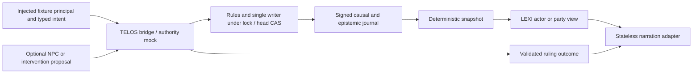
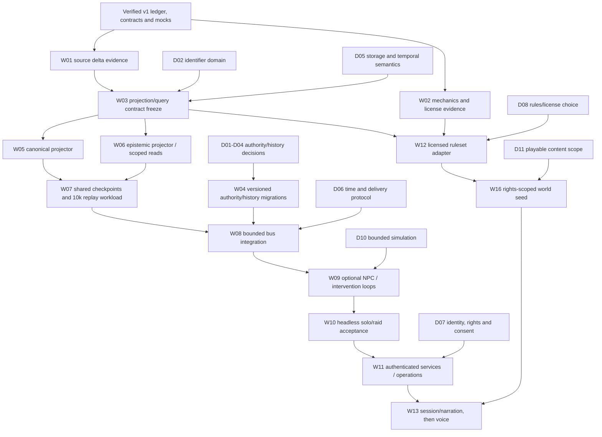
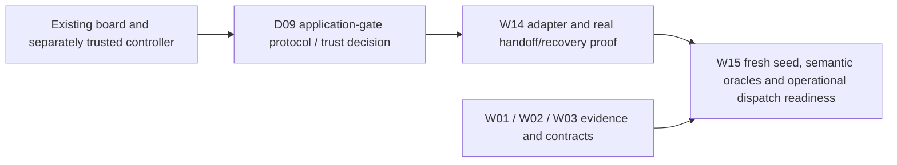

# ARGO system roadmap: present, target and the path between

Baseline **`eb2d4c57d409458d09bf27d4a70ebb067e8e7a8f`**, checked 2026-11-13. [Main CI passed](https://github.com/dsmcewan/ARGO/actions/runs/43469765446) for that exact commit. The [repair evidence](REPAIRS/acceptance/verification.json) records the integrated code at `ff22632`; later documentation does not change its runtime. Twelve review findings are repaired; four remain explicit design decisions.

**We have enough evidence to define the system and sequence the work. We do not yet have every decision, data asset or implemented service needed to deliver the target.** The current product is a verified offline foundation: signed authority, scoped knowledge mocks, deterministic rules and build tooling. The target is a persistent, multi-actor world with separate fact and belief projections, bounded off-screen activity, and reliable solo/party interaction.

Read this document for the system and build order; use [the JSON dependency map](docs/roadmap/system.json) for IDs, dependencies, proposed paths, owners and acceptance criteria. The JSON is explicitly **non-executable**. It is not a new board seed, a schema freeze, a storage-engine choice or approval for paid runs. [The Bible](ARGO_SYSTEM_BIBLE.md) and [frozen v1 contracts](SYSTEMS/CONTRACT_FREEZE.json) remain normative; [the inventory](REPO_INVENTORY.md) and [research](RESEARCH/README.md) retain their evidence and limits.

## What exists now

The original audit → contract freeze → harness repair → sequential foundation spine is complete within its offline scope. This does not mean the full persistent-world product is complete.

| Component / files | What works | Boundary still missing |
| --- | --- | --- |
| **contracts** — [SYSTEMS/argo-v1.schema.json](SYSTEMS/argo-v1.schema.json) | 36 frozen v1 definitions, generated TypeScript, canonical codec and disclosure guards | A schema checks shape and required scope, not authenticated identity or entitlement. |
| **authority-ledger** — [packages/ledger/src/index.ts](packages/ledger/src/index.ts) | Signed causal/epistemic file journal, deterministic reducer/replay, writer lock/CAS, scoped grants and consent | Current rules are the Tempted Fates integration kernel; external history/receipt assurances still have four open decisions. |
| **lexi-bridge** — [packages/lexi-bridge/src/index.ts](packages/lexi-bridge/src/index.ts) | Async scoped query and snapshot-based actor/party knowledge mock | No persistent gameplay KG; no configured transport means UNAVAILABLE. |
| **telos-bridge** — [packages/telos-bridge/src/index.ts](packages/telos-bridge/src/index.ts) | Async proposal submission and in-process authority delegation | No deployed gameplay endpoint; complete response binding is R06. |
| **dm** — [packages/argo-dm/src/index.ts](packages/argo-dm/src/index.ts) | Typed proposal builder, three narrator personas and refreshed cutoff-safe rendering | Not a general natural-language intent parser, production gateway, session UI or voice stack. |
| **autonomy** — [packages/interventions/src/index.ts](packages/interventions/src/index.ts) | Bounded proposal subscriber and async-iterator runner | No general event bus or persistent off-screen world simulator. |
| **scenario** — [scenarios/tempted-fates/index.ts](scenarios/tempted-fates/index.ts) | Independent Fates and deterministic Tempted Fates integration seed | No automatic anomaly trigger or guaranteed quest; illustrative dialogue is not an event script. |
| **model-client** — [packages/model-client/README.md](packages/model-client/README.md) | Reusable vendor policy, budget/cooldown/failover and SDK adapters with public TypeScript types | Offline serialization and failure tests do not prove live provider access, price or quotas. |
| **python-board** — [tools/board.py](tools/board.py) | SQLite WAL, fenced leases, DAG/path locks, CAS, data gates and real Git integration | Data-validator acceptance only; application/control-policy repairs need separate reviewed acceptance. |
| **controller** — [controller/README.md](controller/README.md) | Ten-group acceptance, trusted policy, read-only candidate staging and exact safe fast-forward | Entire Python tools control plane must be trusted before its in-process tests execute. |
| **pantheon** — [pantheon/src/board/index.mjs](pantheon/src/board/index.mjs) | Active JavaScript build harness and its own content-addressed board | Separate from Python board and gameplay state; historical seat-core mirror is not the active client. |
| **legacy-platforms** — [REPO_INVENTORY.md](REPO_INVENTORY.md) | Pinned LEXI forensic and TELOS build-platform catalogs | Source catalogs are retained; source copies and private live databases are not included. |
| **two-plane-graphs-and-bus** — [RESEARCH/HEADLESS_FOUNDATION.md](RESEARCH/HEADLESS_FOUNDATION.md) | Canonical/epistemic stores, common projection checkpoints and bounded component bus are target capabilities | Storage engine, temporal contracts, delivery semantics and migration remain design work. |

The public local authority surface is `openLedger(...).submit/snapshot/events`, with `replay`, `draw`, `initialSnapshot` and `makeCheckpoint`. Raw snapshots, complete events, seeds and hidden rolls are authority-only surfaces. LEXI exposes `createLexiBridge`/`projectKnowledge`/`createLexiMock`; TELOS exposes `createTelosBridge`/`createTelosMock`. These are TypeScript/in-process interfaces, not discovered HTTP gameplay routes. `proposalFromAction` is a typed action builder, not a finished natural-language parser.

The current gameplay path is:



### Current storage and tables

These stores belong to different domains. They must not be joined into one mutable database just because several use hashes, graphs or the word “campaign.”

| Store | Exact artifacts | Authority and current behavior |
| --- | --- | --- |
| Gameplay ledger, caller-selected directory | `genesis.json`, `events.jsonl`, `snapshot.json`, `writer.lock`; atomic-write temporary files | Genesis and signed events define history. Snapshot is derived; reads replay the journal. Cross-process locking and expected head/sequence serialize actions. No automatic stale-lock stealing. |
| Python build board, configurable directory | `board.db` with WAL/SHM as applicable; `cas/<first-two-hex>/<sha256>`; `tickets/<id>.json` and `.spec`; worktrees, gates, `merge.lock`, rendered `BOARD.md` | Coordinates build work. It never stores fictional truth. Only accepted artifacts from merged dependencies reach downstream workers. |
| Active Pantheon build store | `objects/<codec>/<prefix>/<tail>`, `refs/`, runtime lease/occupancy/budget JSON and logs | A separate retained harness board; it is not the new Python SQLite database. See [CAS](pantheon/src/board/cas.mjs) and [runtime](pantheon/src/board/runtime.mjs). |
| Model-client cooldown store | `<sha256(pool)>.json` plus `.lock` | Version, pool, refusal deadline and reason; concurrent successes cannot erase active refusals. Contains no world knowledge. |
| Audited legacy LEXI | Source evidence names `data/LEXI.db`; optional SQLCipher when configured | Forensic domain, not an established gameplay KG. The live database and keys were not inspected or imported. |

The five build-board tables are [defined in `tools/board.py`](tools/board.py):

| Table | Contents |
| --- | --- |
| `meta` | Immutable canonical seed and initial Git commit. |
| `tickets` | Task/policy/spec identity, state/revision, attempt/epoch, lease, worktree/base/candidate, gate/review results, error, merged commit and durable `merge_intent`. |
| `dependencies` | Ticket DAG edges. |
| `artifacts` | Ticket/attempt/logical-path references to CAS hashes and acceptance flags. |
| `audit` | Ordered event, ticket context, canonical payload, prior hash and entry hash. This is a local integrity chain, not an external rollback anchor. |

The gameplay `Snapshot` has `genesis`, `sequence`, `head`, `world_time`, `actors`, `items`, `claims`, `consents`, `grants`, `cutoffs`, `transfers`, `rng_counter` and `proposals`. Actor records include alive/time balance/age/Fate role/thread; items include custodian and destruction state. See [generated types](packages/contracts/src/generated.ts) and [mechanics](packages/ledger/src/mechanics.ts). These records are already enough to test custody, observations, gifts, grants and replay. They are not a complete geography, combat, inventory, economy or faction ruleset.

## What we are building toward

A player observes only what their actor can know, declares intent, receives a deterministic ruling where rules/RNG apply, and sees consequences persist. Other actors and bounded background processes may act between sessions. A narrator presents the result; it cannot make prose into truth.

| Target subsystem | Exclusive writes | Permitted read/input surface | Gap from today |
| --- | --- | --- | --- |
| Action authority | Validated causal and epistemic journal commits | Untrusted proposals, authorized current state, versioned rules and grants | Strengthen receipt/history assurances; implement authenticated service boundaries and later rulesets. |
| Plane A canonical projector | Separate canonical materialization | Committed journal prefix | New entity/edge/custody/clock projection, temporal intervals and durable cursor. Agents never write it. |
| Plane B / LEXI projector | Separate epistemic materialization | Committed observation/disclosure records and permitted canonical context | New reified claims/rumors/provenance, actor-acquisition indexes and scoped query API. |
| Component bus and session coordinator | Delivery/checkpoint/transport records, not world truth | Typed messages and acknowledgements | Bounded queues, retry/backpressure, cursor recovery and explicit delivery-to-observation semantics. |
| NPC runtime and independent intervention planner | Scratch state and candidate proposal queues only | NPC actor-scoped views; specifically authorized intervention triggers | Deterministic tick budgets and separate principals; optional proposals through TELOS. No forced quests. |
| Gateway and narration | Ephemeral transport/session state | Authorized views and authenticated ruling receipts | Real identity/rights/consent binding, intent parsing and player interaction. Text first; voice after turn and disclosure semantics pass. |
| Build control plane | Ticket state, artifacts and verified Git integration | Immutable task inputs and trusted gate policy | Reviewed application-gate adapter plus semantic research/audit oracles before multiplied autonomous code lanes. |

The intended graph architecture has separate canonical and epistemic planes. **The gameplay storage engine is not selected.** SQLite/adjacency tables are a proposed starting option, not a conclusion forced by LEXI or the build board; PostgreSQL or a graph database must be assessed against actual requirements, not assumed. The core remains TypeScript/Node unless a reviewed change says otherwise.

The immutable genesis, authoritative events, derived physical state, actor beliefs and narrative surfaces remain separate layers. External accounts stay attributed claims rather than automatic world truth. V1 observations already distinguish `belief`, `rumor` and `external_account`; future graph nodes for promises or richer observations require a reviewed representation. A promise proves neither fulfillment nor informed consent. Rumor truth assessments must be separately authorized and time-relative: outdated is not automatically false.

Four notions of time must stay distinct:

1. **World valid time:** when a world fact or relationship applies. Proposed graph intervals need explicit boundaries and correction rules.
2. **Recorded sequence:** which ledger prefix contains the information. The proposed second temporal axis is deterministic ledger sequence, not wall-clock arrival.
3. **Actor acquisition:** when that actor learned a claim. V1 `as_of_world_time` filters acquisition, and `as_of_sequence` limits the prefix; `Observation.occurred_at` is not acquisition time. Do not silently reinterpret the existing query fields as generic bitemporal queries.
4. **Current presentation policy:** committed anomaly cutoffs still restrict historical queries; rewinding the view cannot reopen forbidden exposition.

A future scoped graph query must require full tenant/rights/workspace/campaign/world/branch scope, an authenticated viewer, appropriate time/prefix cutoffs and a consistent projection checkpoint. Required fields prevent omitted context; runtime authentication/authorization still has to reject forged context. Both projectors must expose a common confirmed prefix or refuse a mixed-prefix view.

World time currently advances only through authorized `advance_time`; one v1 tick is one second. There is no implicit real-time catch-up, aging debit or off-screen simulation. `serialize`/`reject` are supported; queue/fork are reserved and refused. Their scheduling and any branch-return semantics need explicit decisions. Speech becoming knowledge needs a committed observation protocol: generated words alone do not establish who heard them.

## Data and evidence available

| Asset | Availability | What it can support / what it cannot prove |
| --- | --- | --- |
| [audit-catalogs](repo-audit/evidence/source-manifest.json) | **tracked** — 840 verified blob records and 525 module classifications across the original audit sources and supplied Pantheon folders | Pinned historical evidence; active ARGO/Pantheon implementation has later commits. |
| [legacy-source-bundles](repo-audit/evidence/LEXI-tree.json) | **catalog_only** — LEXI 288 files; TELOS 137; claude-config 142, with tree indexes and per-file hashes | Restore and verify the exact source bundle for refreshed extraction. Recorded tree IDs must not be relabeled as proven commit IDs. |
| [lexi-interfaces](repo-audit/evidence/lexi-routes.json) | **tracked** — 170 route declarations;114 class declarations;104 direct BaseModel/SQLModel subclasses;25 SQLModel table declarations | Not live OpenAPI, a complete physical database inventory, or actor-scoped gameplay APIs. |
| [scenario-source](SCENARIOS/Tempted_Fates.md) | **tracked** — Supplied 17,573-byte Tempted Fates source with pinned digest | Supplied content is not a public redistribution grant or a complete world dataset. |
| [gameplay-fixtures](TESTS/fixtures.ts) | **fixture_only** — Synthetic genesis/actors/party/item and observation example; ephemeral test keys and fake transport/model replies | Sufficient for offline substrate proofs, not a production campaign or consent corpus. |
| [starter-research](RESEARCH/manifest.json) | **tracked** — Five source-backed reports, JSON sidecars, local synthesis and future benchmarks | Starter research only; no named vendor synthesis/architect pipeline ran and proposed benchmarks are not implemented tests. |
| [rules-license-pack](RESEARCH/findings/04_open_rulesets.md) | **missing_or_unverified** — Exact selected rule bytes, license attribution bundle and executable rule fixtures remain needed | Knave1e is provisional; edition/material boundaries and Year Zero applicability remain unresolved. |
| [live-services-and-world-data](STATUS_AND_ARCHITECTURE.md) | **missing_or_unverified** — No deployed gameplay endpoints, populated gameplay graphs or production world/case corpus are established | Deployment/auth/entitlements/consent operations and rights-scoped campaign content are future inputs. |
| [verification-evidence](REPAIRS/acceptance/verification.json) | **tracked** — Repair review, ten-group local gate, negative-controller probes and GitHub Actions CI identities | Offline assurance only; historical suite totals are not a current unique-test census. |

The external-source tree indexes record LEXI `c190e245965447b369a33d928c4f09da33a68d67`, TELOS `52787e7ff73d109cf844f4bc2eb5d5cabd2a82f5` and claude-config `d418728bc58e6bbcb1d4457ee3c780d857f07a91` as tree identities. Do not relabel them as independently verified commit identities. The supplied Pantheon archive is separately tied to ARGO commit `6f75c29c8e66df2c76996c33b763390807d62bda`; the active tree has later repairs. Source-copy restoration must preserve recorded blobs/symlinks before running the extractor.

### Audited LEXI table declarations

The catalog retains exact fields/source lines for all 25 declarations below in [lexi-models.json](repo-audit/evidence/lexi-models.json). These descriptive groups are navigation aids, not a new schema or evidence of populated tables. Other SQL objects/views may exist beyond these ORM declarations.

| Group | Declared tables |
| --- | --- |
| Timeline (2) | `Timeline`, `timeline_annotations` |
| Documents/deposition (7) | `case_documents`, `document_message_links`, `deposition_sessions`, `deposition_traps`, `deposition_questions`, `question_evidence`, `deposition_evidence` |
| Campaign/incident analysis (6) | `manipulation_campaigns`, `escalation_sequences`, `detected_campaigns`, `detected_incidents`, `incident_messages`, `campaign_incidents` |
| Narrative clusters (3) | `narrative_clusters`, `cluster_elements`, `cluster_summary_history` |
| Profiles/behavior/authority (4) | `third_party_authority`, `behavioral_patterns`, `hcp_temporal_tracking`, `hcp_profiles` |
| Communications/analysis (3) | `communications`, `violation_analysis`, `lexi_tactics` |

An audited forensic “campaign” is not an ARGO campaign namespace. No existing LEXI route is directly exposed as a player knowledge API. Use provenance/temporal/storage utilities only through reviewed adapters; do not join a private case corpus into public campaign context. The source audit did not access that corpus.

### Research and licensing inputs

The five reports address referee/session loops, sandbox concurrency/rumors, world ticks/ecology, open rulesets, and Foundry/AI-tool failure hypotheses. Each has a machine-readable sidecar distinguishing evidence, inference, hypotheses and future tests. They provide design inputs, not completed vendor research or runtime benchmarks.

The [ruleset report](RESEARCH/findings/04_open_rulesets.md) provisionally favors **Knave 1e**, subject to pinned rule bytes and fixtures. It distinguishes CC BY 4.0 Knave1e from Knave2e; Cairn1e is CC BY-SA 4.0; Blades SRD is CC BY 3.0 with excluded non-SRD material; D&D SRD5.2.1 is CC BY 4.0, not a grant to unrelated art/products. OSE's proposed future license is not current permission, and full Year Zero terms/AI applicability remain unresolved. Final selection needs the actual license/material bundle and attribution plan. A new licensed kernel does not block projection testing with existing Tempted Fates actions.

What still has to be supplied or decided: verified source bundles for deeper reuse audits; exact selected rules and rights records; first-playable world/content scope; production identity/entitlement/consent operations; storage/recovery requirements; target load/session/latency budgets. None requires uploading private case data or credentials into this repository.

## Decisions before implementation

`ready_for_design` means there is enough context to draft and review a decision. It does **not** mean that the decision is resolved, implementation is authorized, or missing inputs may be guessed. All decisions below are open. R06/R10/R12/R13 remain the four deferred repair findings.

### D01 — Bind outcomes to authenticated scope and full proposals (R06)

**Owner:** authority + contracts. **Deliverable:** Versioned receipt/verification ADR and v1 compatibility proposal.

**Needed input:** Authority trust/key-distribution model and transport envelope choice; distinguish outcome receipts from donor consent receipts.

**Acceptance:** Reject foreign scope/authority and different requests sharing ID, type, sequence and time; exact retries retain identity.

### D02 — Make identifier and canonical-map domains agree (R10)

**Owner:** contracts + authority. **Deliverable:** Identifier-domain or map-encoding ADR, inventory of affected IDs and migration fixtures.

**Needed input:** Compatibility requirements for persisted v1 records and all proposed graph identifiers.

**Acceptance:** Every permitted ID round-trips and replays; unsafe IDs fail before mutation; no silent renaming of signed history.

### D03 — Authenticate genesis for standalone import/rebuild (R12)

**Owner:** authority + operations. **Deliverable:** Versioned genesis commitment or authenticated import-manifest design.

**Needed input:** Trust source for imported genesis; legacy-history anchoring and private seed handling.

**Acceptance:** Changing any initial actor/item/balance/party/clock/seed under an unchanged event head fails authenticated import.

### D04 — Choose storage rollback and recovery assurance (R13)

**Owner:** operations + authority. **Deliverable:** Explicit storage trust/restore ADR; independent monotonic-anchor protocol if that assurance is selected.

**Needed input:** Threat model, backup/restore objectives, availability tradeoffs and independent checkpoint owner. Another file in the same rollback domain is insufficient.

**Acceptance:** If selected, reject pre-revocation prefix/whole-directory rollback and conflicting heads; define checkpoint-unavailable and append/checkpoint crash behavior.

### D05 — Specify two-plane storage and temporal/query semantics

**Owner:** knowledge + contracts. **Deliverable:** Storage ADR and v1-to-proposed temporal mapping: valid time, recorded sequence, acquisition and shared projection checkpoints.

**Needed input:** Target workload, store separation, transaction/cursor strategy, rebuild/recovery needs and pinned source delta evidence. SQLite is a candidate, not an established gameplay store.

**Acceptance:** Worked delayed/equal-tick/correction timelines have unambiguous answers; unscoped, foreign, future-acquired and mixed-prefix reads fail.

### D06 — Define expedition/session world-time and disclosure delivery

**Owner:** mechanics + session coordination. **Deliverable:** Clock-driving, solo/raid checkpoint and delivery-to-epistemic-commit protocol.

**Needed input:** Supported release modes, real-time cadence/catch-up policy, what counts as heard/observed and fork return policy if forks are selected.

**Acceptance:** Pause/retry/reorder/cancellation do not silently advance time, duplicate observations or merge private facts; each supported conflict mode has deterministic behavior.

### D07 — Bind identity, rights and consent at live service boundaries

**Owner:** gateway + operations. **Deliverable:** Authenticated principal/entitlement/consent-capture and revocation design.

**Needed input:** Identity provider, content entitlements, receipt provenance and key/custody operations. Mandatory JSON fields alone are not authentication.

**Acceptance:** Forged actor/tenant/right claims, cache crossover and narrator-made consent fail at runtime; disclosure is rechecked at delivery.

### D08 — Select a source-pinned licensed rules kernel

**Owner:** mechanics + content rights. **Deliverable:** Edition-specific material/license/attribution decision and minimal ruleset scope.

**Needed input:** Exact rule text and redistribution/adaptation terms; Knave1e remains provisional, with no Knave2e inheritance.

**Acceptance:** Selected rule bytes and license are hashed and reviewed; executable examples reproduce rules; excluded setting/art/product material stays excluded.

### D09 — Connect application verification to board acceptance safely

**Owner:** build-control + controller. **Deliverable:** Reviewed external gate/receipt protocol and a single owner of Git integration/recovery.

**Needed input:** Choose how board and separately trusted controller coordinate; do not execute arbitrary application imports inside the data-validator oracle.

**Acceptance:** A worker cannot forge success; receipts bind exact candidate/tree/policy/base; timeout, stale base, crash/recovery and artifact handoff are deterministic.

### D10 — Specify deterministic background simulation budgets

**Owner:** mechanics + autonomy. **Deliverable:** Discrete tick, RNG slot, scheduling and resource-budget design.

**Needed input:** Selected simulation granularity and budgets. Starter R3 cadence/caps are hypotheses, not measured production limits.

**Acceptance:** Identical seed/events yield identical proposals/effects; rejected/empty proposals have no side effects; backlog and resource use are bounded.

### D11 — Define the first playable world and content provenance

**Owner:** product + content rights. **Deliverable:** Playable scope/world-seed manifest and import policy.

**Needed input:** Chosen world, session modes, ruleset and licensed/homebrew assets. The supplied scenario is an integration slice, not a populated general sandbox.

**Acceptance:** Every entity/item/faction/source has explicit scope, origin and rights; imported material cannot grant authority or silently become canon.

These decisions are capability-specific. R06 blocks trusting a remote outcome's full binding; R12 blocks treating an unanchored standalone replay head as genesis authentication; R13 blocks claiming rollback resistance unless selected and implemented. They do not forbid source research, fixture design or local projection experiments against a verified existing genesis. Shared contract edits are serialized through the contracts owner.

## Dependency order

The original four-phase spine remains complete. The following is the **next** build graph, not a rewrite of that history. IDs correspond to the non-executable JSON map. Arrows mean acceptance prerequisites; design and fixture work may start earlier without claiming the dependent feature works.



The diagram emphasizes the gameplay spine; the JSON map includes the full prerequisite sets. The build-control path is separate:



W14 does not need a gameplay graph. Gameplay design does not need W14: the separately trusted controller can continue to verify manually coordinated work. Multiplied **application-ticket acceptance through the board** does need W14. Paid execution additionally needs separate authorization and provider/credential readiness; this document supplies neither.

| ID / deliverable | Prerequisites | Completion evidence |
| --- | --- | --- |
| **W01 — Refresh exact source/storage delta evidence** (audit) | Verified baseline; can draft now | Verified source bundle references, API/table/edge/encryption/tenant and async capability-gap matrix. Every reuse claim names a pinned file/symbol/hash; unavailable source remains explicit; no legacy database or repository mutation. |
| **W02 — Pin mechanics, license evidence and adversarial fixtures** (research) | Verified baseline; can draft now | Evidence-backed timeline/rumor/tick/session examples, selected license/source bytes and benchmark fixtures. Separate source claims from hypotheses; retain provenance and edition-specific grants; do not label proposals as executed benchmarks. |
| **W03 — Freeze reviewed projection/query contracts** (contracts) | W01, D02, D05 | Versioned proposal/migration and negative fixtures for graph records, scoped queries, cursors and common checkpoints. Schema conformance plus runtime negative tests reject foreign/unscoped/mixed-prefix/future-acquired views; v1 remains readable under explicit compatibility. |
| **W04 — Implement reviewed authority/history migrations** (authority) | D01, D02, D03, D04 | Versioned receipt, identifier and authenticated-history changes; selected rollback protocol or explicit bounded trust model. Cross-scope receipt and changed-genesis import fail; old histories retain defined replay; selected restore guarantees are tested before reliance. |
| **W05 — Build canonical Plane A projector** (canonical projection) | W03 | Deterministic entity/edge/custody/clock projection with a durable prefix cursor. Rebuild and incremental results match at every sampled prefix; direct agent writes are impossible through public APIs; crash/restart cannot advance cursor past durable state. |
| **W06 — Build epistemic Plane B and scoped reads** (knowledge) | W03 | Actor-scoped claim/rumor/observation/provenance index and a projection-backed LEXI adapter. Private-to-party, rights-lane and future-acquisition leakage fail; contradictory accounts coexist without replacing canon; replay preserves disclosure. |
| **W07 — Prove shared-checkpoint replay at scale** (verification + projection integration) | W05, W06 | Common-checkpoint integration and a seeded 10,000-event workload with retained failing traces. Sampled-prefix rebuilds equal incremental state and both graph hashes; custody contention, rumors, disclosures and authorized clock jumps are covered. |
| **W08 — Integrate the bounded component bus** (transport + authority) | W07, W04, D06 | Versioned message delivery/acknowledgement, durable cursors and bounded retry/backpressure through the authority boundary. Duplicate/reordered delivery, lag, cancellation and stale heads cannot double-apply actions or mix views; delivery uncertainty is reconciled by identity. |
| **W09 — Add optional NPC and intervention loops** (autonomy) | W08, D10 | Separate bounded principals consuming authorized views/triggers and submitting optional proposals. No direct ledger/graph writes, forced quests, fabricated consent or hidden-roll disclosure; empty/rejected proposals leave canon unchanged. |
| **W10 — Pass headless solo/raid and concurrency acceptance** (integration verification) | W07, W08, W09, D06 | End-to-end headless checkpoints, explicit disclosures and failure/recovery workloads. Race contention has deterministic results; solo secrets stay private; no zombie effects; seeded replay and Tempted Fates cutoff/jurisdiction tests remain green. |
| **W11 — Provide authenticated services and operational recovery** (services + operations) | W10, W04, D07, D04 | Real domain transports, principal/entitlement/consent enforcement, key operations, backups and selected restore guarantees. Authenticated integration tests enforce scope and rights end-to-end; backup/restore drills meet the selected trust model; unavailable services fail closed. |
| **W12 — Add the selected licensed ruleset adapter** (mechanics) | W02, D08, W03 | Reviewed versioned ruleset extension/registry and source-pinned minimal kernel, retaining Tempted Fates compatibility. Deterministic rule fixtures and replay pass; attribution is retained; no new fields or state model are invented outside contract review. |
| **W13 — Build player-facing session/narration then voice** (gateway + presentation) | W10, W11, W12, W16 | Intent/session coordinator over rulings and scoped views; text interaction first, voice after turn/cancellation/disclosure semantics pass. Prose cannot mutate truth; partial speech and interruptions cannot invent knowledge or consent; actor visibility and anomaly cutoffs survive live turns. |
| **W14 — Implement the reviewed board application adapter** (build-control) | D09 | External application verification/recovery integration, fresh immutable seed/policy and real handoff fixtures. Altered/stale/forged receipts and early exits fail; crash/recovery yields one real merge and accepted CAS handoff; no self-grading. |
| **W15 — Enable operational worker dispatch only after readiness** (build operations) | W14, W01, W02, W03 | Reviewed semantic oracles and immutable dependency/path scopes; credential/capacity/cancellation policy for any future provider dispatch. Audit/synthesis/architecture gates no longer return GATE_NOT_IMPLEMENTED; zombie/429/lease loss and quotas are tested; explicit paid-run authorization is separately required. |
| **W16 — Prepare a rights-scoped playable world seed** (content + world bootstrap) | D11, D07, W12, D03 | Validated, provenance-bearing world seed and content ingestion fixtures compatible with the chosen ruleset. No private/licensed context bleed or imported privilege grants; seed identity and rights are verified; no mandatory storyline or automatic anomaly-farming trigger. |

### Parallelism and file ownership

Source audit, temporal/storage design, authority/history ADRs, time/session research, verification-fixture design and the build-adapter design can proceed as separate read/design lanes now. W05 and W06 can implement concurrently **after** their common contracts and package scaffolding are reviewed. W12 can proceed independently of graph implementation after its own rules/license and contract prerequisites. Final acceptance of the bus/autonomy/product waits on the graph shown above.

The JSON `proposed_paths` are path reservations for planning, not active write locks. New directories such as `packages/kg/`, `packages/bus/`, `packages/npcs/`, `packages/rulesets/`, `services/` and `apps/` do not exist as implemented packages today. The contract owner must settle common exports/manifests/cursors before fan-out. If W03/W04 both touch `packages/contracts/`, or W04/W08 touch `packages/telos-bridge/`, their write tickets serialize. A supervisor must split overlapping broad reservations such as `RESEARCH/findings/` or `scenarios/` into disjoint immutable ticket paths before concurrent claims. Maintenance roles in [OWNERSHIP.json](OWNERSHIP.json) are advisory; actual board claims enforce prefix ownership.

## Next work

The next useful output is a reviewed **headless design and evidence packet**, not more persona prose. Prepare these bounded deliverables with separate ownership; none needs paid inference:

1. **W01 evidence refresh:** recover/verify selected source snapshots and produce exact reuse-versus-new boundary findings. Do not run legacy migrations or infer a live database from ORM declarations.
2. **D05 + D02 contract preparation:** write a storage comparison, worked temporal examples and identifier compatibility fixtures. Map existing v1 fields before adding `ScopedKGQuery` or replacing head preconditions with a slice hash.
3. **D01/D03/D04 authority packet:** specify outcome identity, genesis authentication and the chosen rollback trust model. Keep these distinct from already implemented consent verification and supplied/file genesis checks.
4. **D06/D10 + W02 interaction fixtures:** pin clock-driving, rumor transmission/delivery, checkpoint collisions and bounded tick hypotheses. Design the 10,000-event generator/trace format now; execute its acceptance only after real projectors exist.
5. **D09 build-adapter packet:** decide who owns Git integration and how an external verifier result is authenticated, bound to exact bytes and recovered. Existing board data validators cannot simply import candidate application code or trust a worker-written result file.

After those decisions and evidence gates, W03 can freeze a reviewed versioned projection/query proposal, W04 can implement its approved authority/history migrations, and the projector lanes can be scoped precisely. W11–W13/W16 require later operational and product inputs; they are not silently authorized by documentation.

The old [11-ticket research seed](RESEARCH/argo_night1_seed.json) remains a planning artifact: three source audits, five research lanes, two syntheses and an architecture proposal. Several semantic oracles deliberately return `GATE_NOT_IMPLEMENTED`; READY in a board only means dependency eligibility. Do not equate schema-valid reports with substantive research completion. Review new policies into a fresh immutable batch rather than modifying an in-flight seed.

The [repair batch](REPAIRS/BOARD.md) is operationally retired with truthful states. This documentation has its own fresh DOC-001 batch and a data-only structure/DAG gate. Documentation validation is within that gate's supported scope; it does not solve W14 or mark future roadmap nodes complete.

## Acceptance gates

| Gate | Required proof | Existing coverage versus new work |
| --- | --- | --- |
| Current foundation/control baseline | Frozen schemas/types/boundaries; complete foundation, board/dispatcher, research and offline Pantheon/model checks; exact candidate policy and safe Git update | The ten-group [gate](scripts/gate.mjs) and [trusted controller](controller/README.md) exist. Native process/Bubblewrap support is required. Exact baseline main CI passed. |
| Contract/identity migration | Negative scoped-query/receipt/identifier/genesis fixtures; explicit legacy compatibility; real auth checks beyond schema fields | W03/W04. Existing v1 freeze and tests must not be edited to waive failures. |
| Projection/replay | Fixed seed + events reconstruct state, Plane A and Plane B; durable common checkpoints; deterministic 10,000-event workload with sampled prefixes and saved failing traces | W05–W07. This graph workload has not already run. |
| Concurrency/bus | Duplicate/reordered delivery, stale view, lag, timeout, cancellation, lease loss and crash recovery preserve one effect and appropriate knowledge | W08–W10. Pre-submit rejection has no effect; timeout after submit may have committed and must reconcile by identity. |
| Rights/service operations | Authenticated principal/entitlement/consent binding, cache isolation and selected backup/restore assurances | D04/D07 + W11; no production deployment certified. |
| World/rules/presentation | Pinned content rights and rules, unforced choices, jurisdiction and post-anomaly cutoff, turn-taking and explicit epistemic delivery | W12/W16/W13; preserve existing Tempted Fates tests. |
| Application board | External independently trusted gate, exact candidate/policy/base binding, bounded execution, real merge/recovery and accepted CAS handoff | D09/W14/W15. Neither a model verdict nor an in-process success receipt is an external trust anchor. |

Useful existing checks, run in a correctly provisioned Node24.22.1/Linux environment:

```sh
npm ci --ignore-scripts --no-audit --no-fund
npm --prefix pantheon ci --ignore-scripts --no-audit --no-fund
node scripts/gate.mjs --merge-ready
```

The last command requires a clean committed checkout. Local gate success is not itself a trusted-policy merge: execute the controller from a separately trusted checkout with the reviewed immutable policy binding. Do not invent future test commands or report a named vendor pipeline as executed; define those tests with their owning subsystem plan.

## Limits

This roadmap establishes the path, not a finish date, cost estimate, storage choice or production readiness claim. The evidence supports current behavior and concrete design work. It does not supply live API credentials/access, private case data, production entitlements, a populated general world, a full selected rules kernel, a deployed service mesh or measured load/latency budgets.

Research/ADR drafting can proceed with these limits stated. Runtime implementation needs the corresponding accepted contracts and test fixtures. Protected controller/board changes need an independently reviewed trust-root update; frozen gameplay changes need a versioned migration. Namespace isolation, hidden rolls, informed gifts, separate Fate jurisdictions, optional interventions and post-anomaly disengagement remain mandatory throughout. No paid runs, database imports, deployments or runtime feature changes are performed by this documentation pass.
