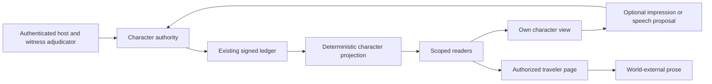

# Characters and the world-external narrator

This implements the available [owner intent](../design-intent/characters-and-narrator/README.md) for **all campaigns** as the additive `character-memory/1.0.0` profile. The historical intent archive remains unchanged. The runtime is headless: it provides library entry points, injected host services and offline tests, rather than a deployed game or UI. Final candidate and verification identities belong in [verification.json](verification.json).

Each observer owns their interpretation of a witnessed act. That interpretation records the observer's nature revision and evidence; it never becomes a property on the traveler or a canonical fact. Characters retain their current activity, can decline to reply, and have explicit speech budgets and intervals. The narrator reads an authorized traveler record through a separate capability and has no gameplay identity or writer.

The low-level `createCharacterAgent` still accepts injected callbacks. The additive [model-backed character adapter](../npc-dialogue/README.md) now supplies that connection through the shared model client: traits, acquired dialogue, private impressions, optional communication goals and explicitly disclosed campaign room/actor context produce free-form speech or silence. SDK clients and authenticated host readers remain injected. Campaign goals are supplemental presentation data, not changes to the frozen character profile; sample speech is excluded. Fixed test replies verify the connection, not live conversational quality. The narrator remains a separate world-external role. The [earlier release scope](../releases/2026-11-14-rpg-foundation.md) records the state before this connection.

## Components

| Package entry point | Capability | Inputs the host must supply |
| --- | --- | --- |
| `@argo/contracts` | Versioned DTOs, runtime shape guards, request hashes | Authenticated identities and state remain outside schema validation |
| `@argo/ledger` — `createCharacterAuthority`, `replayCharacters` | Admit character commands; reconstruct history from signed events | Existing ledger, stable system principal, witness adjudicator |
| `@argo/telos-bridge` — `createCharacterBridge` | Bounded async command transport; bind receipts to submitted request | Authority transport and authenticated principal |
| `@argo/lexi-bridge` — `createCharacterViews` | Filter own impressions and private/party narrator pages | Trusted current projection reader and authenticated viewer |
| `@argo/interventions` — `createCharacterAgent` | Produce optional impression or speech commands | Actor-scoped view, interpretation callback, speech callback |
| `@argo/argo-dm` — `createCharacterNarrator` | Narrate a bounded authorized archive page | Scoped context loader and injected model client |

Public factories are exported by each package's existing entry point. The exact wire grammar is in [API.md](../../SYSTEMS/characters-v1/API.md); [CONTRACT.md](../../SYSTEMS/characters-v1/CONTRACT.md) and [FREEZE.json](../../SYSTEMS/characters-v1/FREEZE.json) pin the interface.



## Host wiring and one turn

The executable example is [character-integration.test.ts](../../TESTS/character-integration.test.ts). It uses a real signed journal, two observers with different natures, actual custody transfers, private and party speech, and injected model responses. The host wiring follows this shape:

```ts
const authority = await createCharacterAuthority({
  ledger, systemPrincipal,
  authorizeWitnesses: async (request, snapshot, {signal}) => {
    const decision = await perceptionService(request, snapshot, signal);
    return {
      request_hash: request.request_hash,
      actor_ids: decision.authorizedObservers,
      party_id: decision.disclosureParty,
    };
  },
});
const commands = createCharacterBridge({
  scope,
  transport: (command, principal, call) => authority.submit(command, principal, call),
});
const hostViews = createCharacterViews({
  scope, readProjection: call => authority.readProjection(call),
});
```

`perceptionService` is a host integration seam, not an implemented geometry or authentication service. The narrator and characters must never receive this combined host wiring, the ledger, the system principal or its signing key. Give a character only its actor view and a proposal channel; give the narrator only a loader already bound to an authenticated viewer.

1. The host configures each actor's nature, activity and speech policy using a `configure` command with the current cursor. Nature revisions start at 1 and increase consecutively.
2. A player's accepted `speak` command takes its speaker from the host-authenticated principal. The host adjudicates who perceived it and whether it was disclosed to a party. For an already committed physical action, the system may submit `witness_action` to record later acquisition at the current time.
3. An observer's `agent.impress(view, subjectId, evidenceIds, requestId)` may return an untrusted command or null. The authority verifies acquisition, ownership, predecessor and nature again before committing it. Interpretation text is recorded once; replay never calls a model.
4. Refresh the actor view after that commit. `agent.respond(view, recordId, requestId)` skips its speech callback when busy, ended, unconfigured, unaddressed, under cooldown or behind a cutoff. The callback may also return null. Accepted speech is separately adjudicated and committed.
5. Load a `CharacterNarratorQuery` at the current cursor. `narrator.narrate({query, prompt, persona})` reads only the authorized page, checks it again before provider attempts and delivery, and discards prose if the context changes. Prose itself appends nothing.

A concurrent commit invalidates the cursor. Refresh and decide again with a new request identity; do not rewrite an old idempotent command in place. Exact retries return the original receipt. A speech grant is bound to the original command hash and cannot be reused for another turn.

## What the record contains

The first configuration activates capture for that world/branch. From then on, the authority retains accepted speech and eligible committed causal actions. Actions use deterministic summaries that omit hidden random values, seeds, consent proofs and private grant material. Earlier chat, rejected attempts and uncommitted model prose are not reconstructed. The first carrier adapter uses the existing `tempted-fates/1.0.0` ledger transport; the character DTOs contain no scenario-specific campaign identifier. Another causal ruleset still needs its own transport/rules adapter.

Private system-authored epistemic carriers stay outside ordinary actor knowledge retrieval. Actor views contain their own latest impression per subject and at most 16 acquired experiences. Selection uses first acquisition time, so learning of an old action can enter current context; granting it again does not make it artificially recent. Reconfiguring nature preserves past records and impressions.

The host archive retains all captured records. The narrator receives pages of 1–128 records, with filtering before pagination. Private narration requires viewer equals traveler. Party narration additionally requires current membership and explicit acquisition in that party's disclosure lane. A party page never gains private solo content simply because the same actor later joins a raid. Global sequence metadata still reveals ordering and gaps; this is not a metadata-oblivious protocol. Paginate explicitly if a host needs more history. Oversized model context is rejected rather than silently truncated. The narrator's `timeoutMs` bounds each context-loader call; provider generation uses the shared router's bounded deadline and the caller's abort signal.

The shared voice policy is a tired, dry, sparingly sarcastic onlooker outside the world. The existing Chronicler, Fates and Plain Guide labels remain presentation hints. Both narrator entry points receive the common policy; only the new entry point has the scoped traveler archive. Prompt policy is not proof of a particular model's tone or prompt-injection immunity. Structural protection comes from scoped input, no world-writing tools and fresh authority checks.

## Limits and next dependencies

- The missing section 4, `abuse-fragments/`, and original open questions 6/7 were not supplied. No abuse-recognition behavior is invented here.
- Authentication, presence, witness legitimacy, entitlements and principal-to-role assignment are trusted host duties. JSON shape or a callback return is not proof of those duties. Direct system/ledger access remains privileged.
- This additive profile does not globally repair older v1 observation spoofing or dead-actor actions. Ordinary forged character markers receive no new authority. The separate review-repair candidate remains separate.
- The existing journal's replay cost, lock/crash recovery and genesis/rollback trust limits remain. This is not the proposed persistent two-plane KG or a 10,000-event performance milestone.
- No background scheduler, general simulation, UI, voice system, deployed LEXI/TELOS service or live provider run is added.
- Production integration needs authenticated host adapters, an independently controlled acceptance policy for the new tests, and the outstanding storage/security work before unattended operation.

## Build and acceptance records

Five blackboard tickets tracked contracts, authority, readers, presentation and integration with disjoint write ownership. The root coordinator enforced contract freeze before dispatching runtime work. Their seed deliberately has no executable application approval gate: Board v1's data-only policy cannot certify runtime code. A submitted ticket is `VERIFYING`, not `MERGED`. Local candidate assembly and passing regressions do not promote a controller trust root.

Run on Node 24.22.1 with dependencies installed offline or through the usual trusted install process:

```sh
npm run contracts
npm run typecheck
npm test
node scripts/gate.mjs --merge-ready
```

The full gate requires Linux Bubblewrap namespaces. Provider fixtures are injected and incur no model usage. [verification.json](verification.json) records exact tested code, logs, separate reviewer scope and board disposition; historical verification elsewhere retains its original scope.
