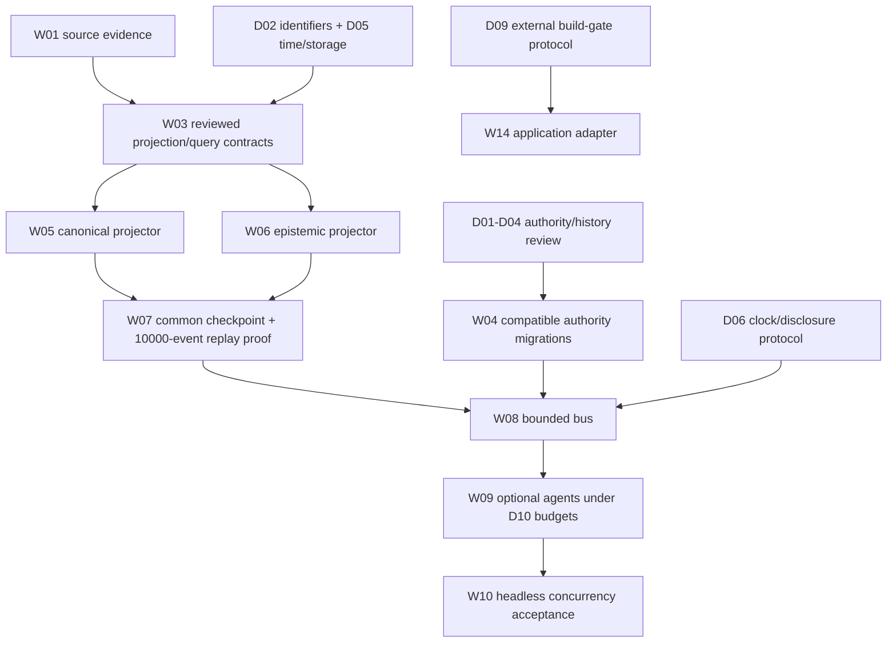

# Headless evidence and decision packet

Status: **proposed; reviewed design is not a contract freeze or runtime implementation**. Source baseline: ARGO `41f2cb8568b53fac984e1114d7342eef540bb6d5`, whose GitHub Actions run [43474715824](https://github.com/dsmcewan/ARGO/actions/runs/43474715824) passed. Gameplay remains the repaired v1 foundation. This packet advances the next design/evidence work identified by [SYSTEM_ROADMAP.md](../../../SYSTEM_ROADMAP.md); it does not change that roadmap's prerequisites or decision statuses.

The goal is a headless world substrate with two separately maintained knowledge planes, deterministic history, explicit authority and delivery boundaries, and independent build acceptance. The current file ledger, scoped projections, injected bridges and build controllers supply the starting point. Persistent gameplay graphs, a component bus and authenticated production services still need implementation and adversarial verification.

## Read the packet

| Document | Decisions / work | What becomes concrete |
| --- | --- | --- |
| [Source delta](source-delta.md), [machine-readable evidence](source-evidence.json) | W01 | Existing source identities, inspected storage/service hooks, changes and unavailable evidence |
| [Temporal storage and identifiers](temporal-storage.md) | D02, D05, D06 | Canonical/epistemic records, acquisition versus valid time, shared checkpoints, identifier compatibility, disclosure semantics |
| [Authority and authenticated history](authority-history.md) | D01, D03, D04 | Proposal-bound outcomes, complete genesis identity, local versus rollback-resistant trust, retry/recovery |
| [Build-gate protocol](build-gate-protocol.md) | D09 | An external application verifier, exact-candidate receipt and one owner of Git integration |
| [Mechanics and fixture design](mechanics-fixtures.md) | W02, D06, D10 | Clock-driving, bounded scheduling/RNG, solo/raid disclosure cases and remaining source/license gaps |
| [Knave 1e evidence bundle](evidence/knave-1e/ATTRIBUTION.md) | W02 / future D08, W17 | Pinned public mirror bytes, author grant evidence, official license and attribution; no kernel adoption |
| [Case catalog](cases.json) | All eight decisions above | Declarative given/when/then cases for future executable tests; none is labeled as an executed benchmark |
| [Packet manifest](packet.json) | Coordination | Code references, proposed outcomes and the next acceptance boundaries |

## Recommendations and their authority

Recommendations in these documents are design proposals. They are concrete enough to challenge with worked examples and turn into versioned schemas, but do not grant a model authority to change frozen v1, reinterpret old signed histories, choose production identity providers or claim rollback resistance. Alternatives and compatibility consequences are part of each proposal.

D01–D06, D09 and D10 now have a bounded design packet. D07 identity/entitlement operations, D08 exact rules/license selection and D11 first playable world still have separate work. A missing commercial rules license does not block local graph tests using the existing Tempted Fates actions. A build-board application adapter does not block gameplay contract design. Shared `packages/contracts/` edits still require one serialized owner.

The critical separation is between historical data and permission to disclose it. An actor's acquisition cutoff does not authorize a global canonical read. A historical checkpoint does not reopen the current anomaly boundary. A transport acknowledgement does not prove a human heard prose. A signed prefix does not establish that no newer revocation ever existed. Each corresponding proposal names the additional verifier or policy needed rather than assigning those meanings to an existing timestamp or signature.

## Dependency path after this packet

This diagram is a reading aid; [the roadmap JSON](../../roadmap/system.json) retains the full dependencies. The next contract packet should include schema drafts, migration examples and executable negative fixtures for W03, followed by explicit contract review. W04 and W14 have independent implementation boundaries after their relevant designs are resolved. Do not start both projectors against lane-local schemas or use this packet as an executable dispatch seed for future runtime work.

## Acceptance and provenance

HD-001 is registered in the fresh local blackboard batch `.board/headless-design/`. Its [immutable specification](HD-001.md) and [seed](seed.json) assign one repository writer and read-only peer contributors. A separate sequential [HD-002 ticket](HD-002.md) reconciles the verified source/rules availability into the roadmap JSON while pinning the complete decision/work arrays unchanged. The supervisor holds the lease; peers neither receive its credentials nor certify their own work. Their native Codex participation does not represent Grok/Gemini/Claude API runs. Host worktree coordination is not a claim that these peers ran inside the confined dispatcher.

The pinned data gate checks coverage, fixture structure, file references and non-execution labels. It cannot prove the proposed graph, rollback anchor or delivery bus works. Independent semantic review is recorded separately. The separately trusted application controller checks the exact final Git candidate before main integration. [Verification](verification.json) and [board snapshot](BOARD.md) are added after actual acceptance and identify the candidate they cover.

Historical audit catalogs and frozen runtime/contracts remain unchanged. New source findings carry their own identities. No private case database, encryption key or credential is part of this packet; no paid vendor call, deployment or runtime migration is performed. Source code proves source behavior only: deployed routes, database migrations and production access controls still require their own authenticated integration evidence.
